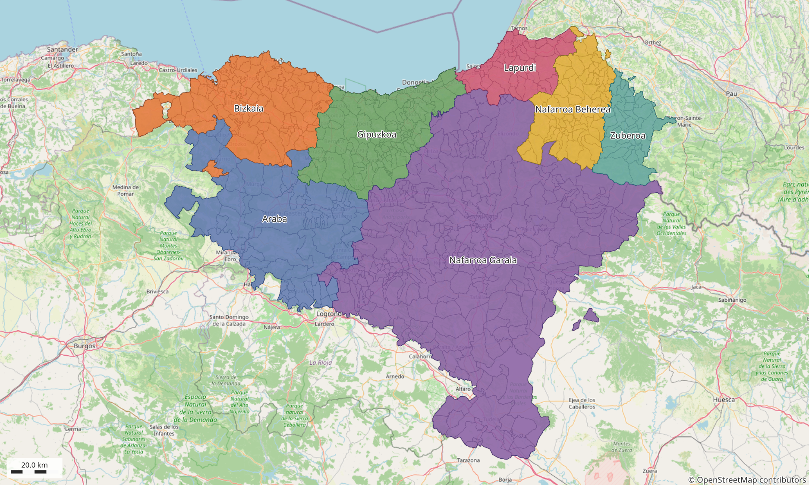
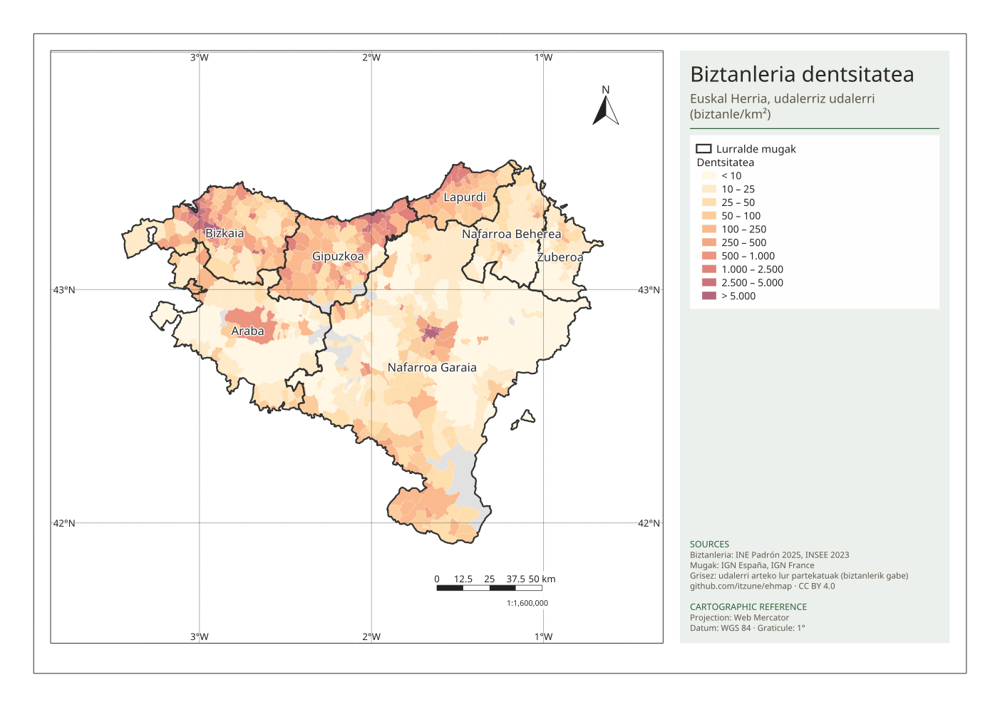
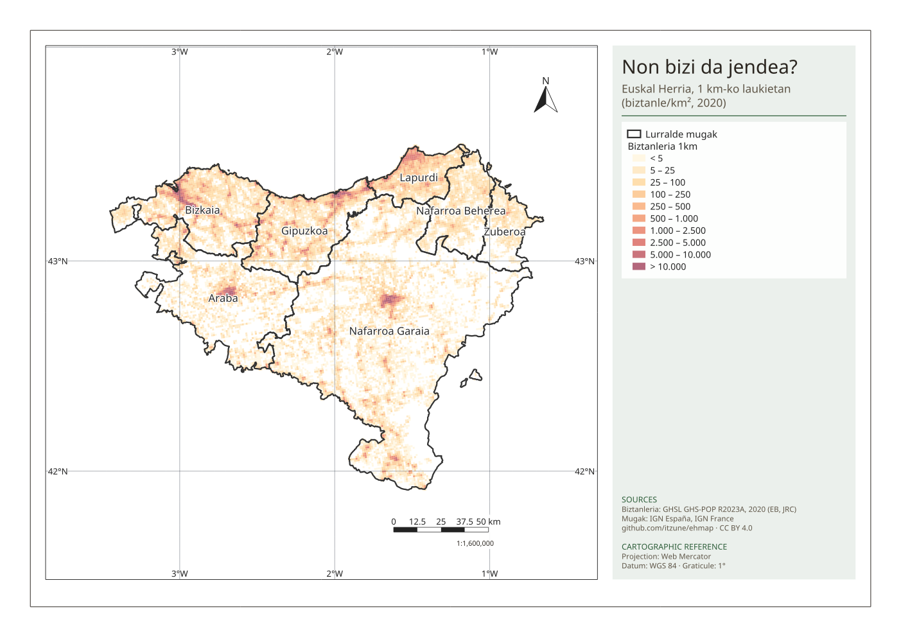
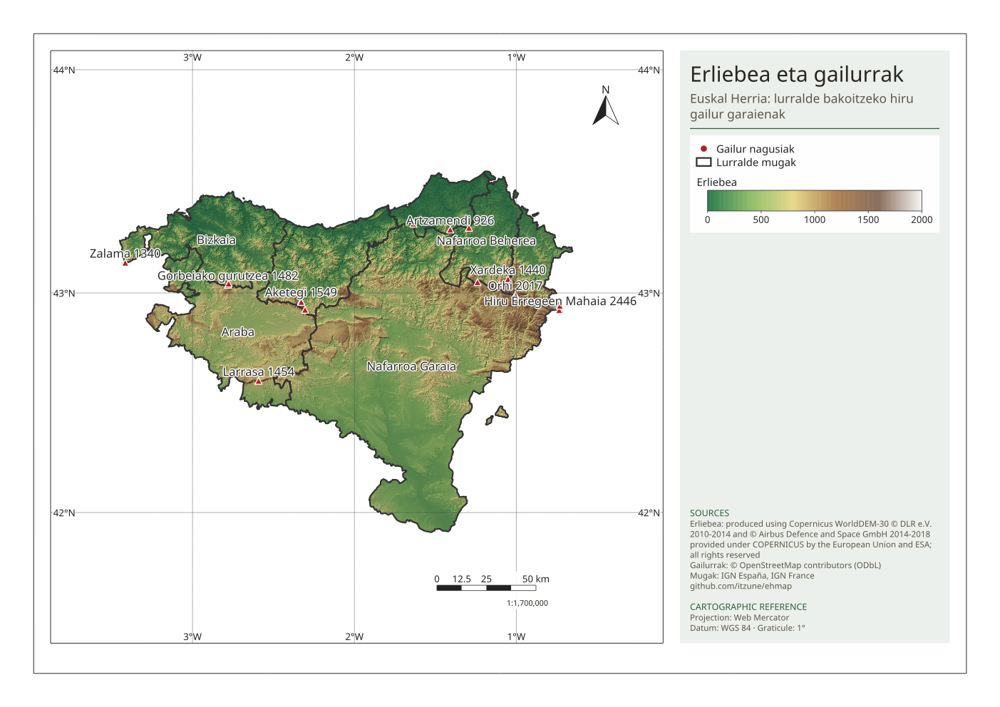
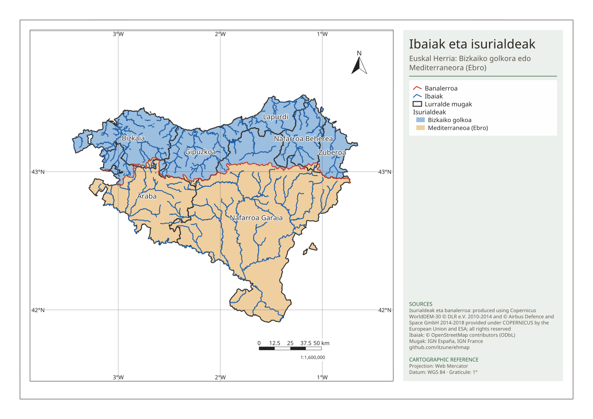
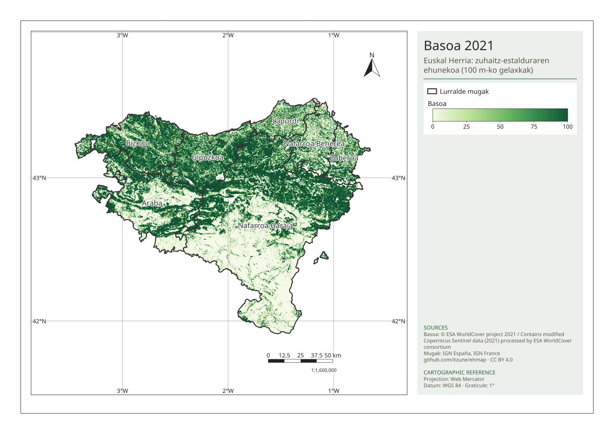
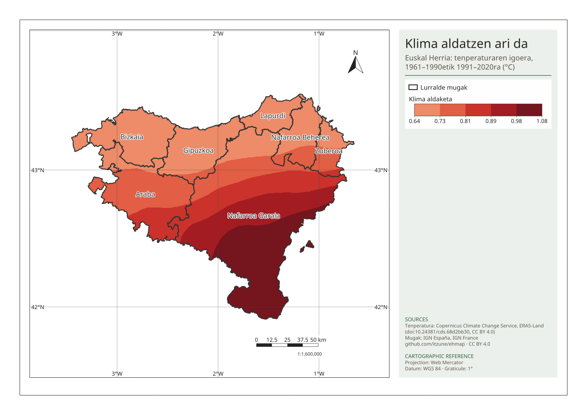

# ehmap — open geodata for Euskal Herria

Open, reproducible base layers of **Euskal Herria and its 7 territories**
(Araba, Bizkaia, Gipuzkoa, Nafarroa Garaia, Lapurdi, Nafarroa Beherea, Zuberoa), ready to use
in any GIS or web map. The goal is that anyone building something about Euskal Herria finds
the base already done, with clear sources and licences.

**Website: [itzune.eus/ehmap](https://itzune.eus/ehmap/)** — the atlas, in Basque.

The project is also a playground to learn [RustGIS](https://github.com/opengeos/RustGIS);
next topic is forest change over the last years.



## Download

Get the files from the **[latest release](https://github.com/itzune/ehmap/releases/latest/)** (stable links below always
point to it). Vector data is also in [`dist/`](dist/) in this repository.

| File | Contents |
|---|---|
| [`ehmap.rgis`](https://github.com/itzune/ehmap/releases/latest/download/ehmap.rgis) | RustGIS project, self-contained: territories, municipalities, population density and population grid (hidden layers + print layouts), over an OpenStreetMap basemap |
| [`euskal_herria.gpkg`](https://github.com/itzune/ehmap/releases/latest/download/euskal_herria.gpkg) | GeoPackage with layers `municipalities`, `territories`, `euskal_herria` (EPSG:4326) — also [`dist/`](dist/) |
| [`euskal_herria_geojson.zip`](https://github.com/itzune/ehmap/releases/latest/download/euskal_herria_geojson.zip) | The same layers as GeoJSON (RFC 7946), full detail and simplified (~50 m, shared borders kept) — also [`dist/geojson/`](dist/geojson/) |
| [`ghs_pop_2020_100m.tif`](https://github.com/itzune/ehmap/releases/latest/download/ghs_pop_2020_100m.tif) | People per 100 m cell (GHSL, 2020), Cloud-Optimized GeoTIFF, EPSG:3035 |
| [`ghs_pop_2020_1km.gpkg`](https://github.com/itzune/ehmap/releases/latest/download/ghs_pop_2020_1km.gpkg) | Inhabited 1 km cells with `grid_id` (Eurostat format), `population`, `territory_id`, EPSG:3035 — also [`dist/population_grid/`](dist/population_grid/) |
| [`copernicus_dem_25m.tif`](https://github.com/itzune/ehmap/releases/latest/download/copernicus_dem_25m.tif) | Elevation (m), 25 m, EPSG:25830, Cloud-Optimized GeoTIFF (90 MB) — Copernicus licence, see below |
| [`copernicus_dem_50m.tif`](https://github.com/itzune/ehmap/releases/latest/download/copernicus_dem_50m.tif) | Lighter elevation: 50 m, whole metres (10 MB) — Copernicus licence |
| [`peaks.gpkg`](https://github.com/itzune/ehmap/releases/latest/download/peaks.gpkg) | 6,269 OpenStreetMap peaks inside Euskal Herria — ODbL; also [`dist/osm/`](dist/osm/) |
| [`rivers.gpkg`](https://github.com/itzune/ehmap/releases/latest/download/rivers.gpkg) | 247 named OpenStreetMap rivers clipped to Euskal Herria — ODbL; also [`dist/osm/`](dist/osm/) |
| [`drainage_basins.gpkg`](https://github.com/itzune/ehmap/releases/latest/download/drainage_basins.gpkg) | Bay of Biscay / Mediterranean sides and the watershed divide, from the DEM — Copernicus licence; also [`dist/elevation/`](dist/elevation/) |
| [`forest_cover_100m.tif`](https://github.com/itzune/ehmap/releases/latest/download/forest_cover_100m.tif) | % tree cover per 100 m cell (ESA WorldCover 2021), EPSG:25830 |
| [`landcover_2021_10m.tif`](https://github.com/itzune/ehmap/releases/latest/download/landcover_2021_10m.tif) | All ESA WorldCover 2021 land cover classes, 10 m, EPSG:25830, with colour table (21 MB) |
| [`SHA256SUMS`](https://github.com/itzune/ehmap/releases/latest/download/SHA256SUMS) | Checksums |

Earlier versions and what changed: [releases](https://github.com/itzune/ehmap/releases),
[CHANGELOG.md](CHANGELOG.md).

### `municipalities` (706 features)

| Field | Description |
|---|---|
| `code` | Official code: INE (Spain) or INSEE (France) |
| `country` | `ES` or `FR` |
| `type` | `municipality` (686) or `shared_land` (20 facerías, parzonerías, Bardenas Reales…) |
| `name` | Official name |
| `name_eu` | Basque name (Wikidata; official name when none) |
| `territory_id`, `territory` | One of the 7 territories (id / Basque name) |
| `admin_province` | Current administrative province or département |
| `wikidata` | Wikidata item ID |
| `note` | Why a unit was assigned where it is, when that is not obvious |
| `area_km2` | Area in km² (computed in ETRS89 / UTM 30N) |
| `population` | Municipal population (empty for shared lands) |
| `population_year` | Reference year: 2025 (INE, 1 January) or 2023 (INSEE) |
| `population_source` | `INE Padrón` or `INSEE PMUN` (population municipale) |
| `density_km2` | Inhabitants per km² |

### `territories` (7 features)

`id`, `name_eu`, `name_es`, `name_fr`, `name_en`, `iso_3166_2` (southern territories only),
`n_municipalities`, `n_shared_lands`, `population`, `area_km2`, `density_km2`.

| Territory | Municipalities | Shared lands | Population | km² | Inh./km² |
|---|---|---|---|---|---|
| Araba (incl. Treviño) | 53 | 2 | 344,194 | 3314.5 | 103.8 |
| Bizkaia | 112 | 0 | 1,162,251 | 2213.8 | 525.0 |
| Gipuzkoa | 88 | 2 | 733,365 | 1980.8 | 370.2 |
| Nafarroa Garaia | 272 | 16 | 683,500 | 10386.8 | 65.8 |
| Lapurdi | 41 | 0 | 282,954 | 866.6 | 326.5 |
| Nafarroa Beherea | 76 | 0 | 33,092 | 1334.8 | 24.8 |
| Zuberoa | 44 | 0 | 14,643 | 824.2 | 17.8 |
| **Euskal Herria** | **686** | **20** | **3,253,999** | **20921** | **155.5** |

Population figures mix reference years: 2025 for the southern territories, 2023 for Iparralde
(INSEE's latest legal populations). Use `population_year` when comparing.

## Population density



Density is shown per municipality with hand-picked classes (the values are very skewed: the
median is 34 inh./km², the densest municipalities pass 14,000). In `ehmap.rgis` it is the
`Dentsitatea` layer (hidden by default) and the `Dentsitatea` print layout.

## Population grid



Municipal densities spread people evenly over each municipality. The
[GHSL](https://doi.org/10.2905/2FF68A52-5B5B-4A22-8F40-C41DA8332CFE) population grid (EU Joint
Research Centre, 2020 estimate) places them where buildings are, so valleys, coastal corridors
and empty mountains show up. It is published here clipped to Euskal Herria, at 100 m (raster)
and aggregated to the Eurostat 1 km grid (vector).

GHSL is a **model**, good for showing where people live but not for exact counts: for this area
it totals 2.97 million people against 3.25 million in the official registers (2023–2025).

| Territory | GHSL 2020 / official |
|---|---|
| Araba | 0.99 |
| Bizkaia | 0.91 |
| Gipuzkoa | 0.87 |
| Nafarroa Garaia | 0.91 |
| Lapurdi | 0.94 |
| Nafarroa Beherea | 0.97 |
| Zuberoa | 0.98 |

For counts, use the municipal `population` field. In `ehmap.rgis` the grid is the
`Biztanleria 1km` layer (zoomed out) and `Biztanleria 100m` (zoomed in), hidden by default,
and the `Biztanleria sareta` print layout.

## Elevation and peaks



Elevation comes from the Copernicus DEM GLO-30, reprojected to 25 m and clipped to Euskal
Herria; it is a surface model (it includes buildings and trees), so summits come out a few
metres lower than their surveyed heights and cities slightly higher. Peaks come from
OpenStreetMap (`natural=peak`). Many summits sit on a border, so each peak lists every
territory within 100 m (`territories`) and is ranked within each of them (`rank`).

| Territory | Mean elevation | Highest peak (OSM) |
|---|---|---|
| Araba | 667 m | Gorbeiako gurutzea 1,482 m (with Bizkaia) |
| Bizkaia | 295 m | Gorbeiako gurutzea 1,482 m (with Araba) |
| Gipuzkoa | 397 m | Aketegi 1,549 m |
| Nafarroa Garaia | 603 m | Hiru Erregeen Mahaia 2,446 m |
| Lapurdi | 110 m | Artzamendi 926 m |
| Nafarroa Beherea | 355 m | Okabe 1,466 m |
| Zuberoa | 536 m | Orhi 2,017 m (with Nafarroa Garaia) |

Per-municipality and per-territory minimum, mean and maximum elevation (and the location of
each territory's highest point) are in [`dist/elevation/`](dist/elevation/). In `ehmap.rgis`:
the `Erliebea` (shaded relief), `Gailurrak` and `Gailur nagusiak` layers, hidden by default,
and the `Erliebea` print layout.

**Known data issues** (to fix upstream in OpenStreetMap): the *Aitxuri* node (usually given as
1,551 m, the top of Gipuzkoa) is tagged 1,508 m and placed where the DEM shows only ~1,425 m,
so the Aitzkorri ridge appears topped by Aketegi instead.

## Rivers and the watershed divide



**Rivers** come from OpenStreetMap (`waterway=river`): each OSM river relation, or same-named
connected segments, is one river; pieces whose names match after normalising ("Zadorra",
"Río Zadorra", "Zadorra ibaia") are joined, also across reservoirs for rivers that have a
relation. Lengths are measured inside Euskal Herria.

| River | km in Euskal Herria | Territories |
|---|---|---|
| Ebro | 160 | Araba, Nafarroa Garaia |
| Arga | 147 | Nafarroa Garaia |
| Ega | 147 | Araba, Nafarroa Garaia |
| Aragoi | 118 | Nafarroa Garaia |
| Irati | 86 | Nafarroa Garaia |
| Arakil | 77 | Araba, Nafarroa Garaia |
| Errobi | 77 | Lapurdi, Nafarroa Beherea |
| Oria | 76 | Gipuzkoa |
| Biduze | 72 | Lapurdi, Nafarroa Beherea |
| Zadorra | 69 | Araba |

**The watershed divide** was computed from the elevation model with the GeoLibre (Whitebox)
hydrology tools that RustGIS uses: breach depressions, D8 flow direction and accumulation,
streams above 10 km² of catchment with their Strahler order, and the watershed of a point on
the Ebro below Zaragoza. The work is done at 100 m over 41–44°N, 4–0°W so that water reaches
its real outlet. **58% of Euskal Herria (12,241 km²) drains to the Mediterranean through the
Ebro, 42% (8,681 km²) to the Bay of Biscay**; the divide runs 401 km inside Euskal Herria.
It is approximate at the scale of a few hundred metres along the ridges.

| Territory | Bay of Biscay km² | Mediterranean km² |
|---|---|---|
| Araba | 455 | 2,860 |
| Bizkaia | 2,153 | 60 — Otxandio, Ubide and the south slopes of Gorbeia–Urkiola |
| Gipuzkoa | 1,936 | 45 — mostly the shared land of the Aitzkorri range |
| Nafarroa Garaia | 1,164 | 9,223 |
| Lapurdi | 867 | — |
| Nafarroa Beherea | 1,302 | 32 — the Irati forest (Lekunberri, Mendibe) |
| Zuberoa | 803 | 21 — the Irati forest (Larraine) |

In `ehmap.rgis`: the `Ibaiak`, `Isurialdeak` and `Banalerroa` layers (hidden by default) and the
`Isurialdeak` print layout. The DEM-derived streams are in
[`dist/elevation/streams_dem.gpkg`](dist/elevation/).

## Forest



The current forest comes from [ESA WorldCover 2021](https://doi.org/10.5281/zenodo.7254221)
(10 m, from Sentinel-1 and Sentinel-2): its *tree cover* class, clipped to Euskal Herria.
It measures **tree cover seen from space** (natural forest and plantations alike), not the
legal or inventory definition of forest, so it runs higher than official forest statistics.

| Territory | Tree cover km² | % of land |
|---|---|---|
| Gipuzkoa | 1,452 | 73.3 |
| Bizkaia | 1,585 | 71.6 |
| Zuberoa | 440 | 53.4 |
| Lapurdi | 429 | 49.5 |
| Araba | 1,608 | 48.5 |
| Nafarroa Beherea | 598 | 44.8 |
| Nafarroa Garaia | 4,252 | 40.9 |
| **Euskal Herria** | **10,365** | **49.5** |

The rest of Euskal Herria is mostly grassland (24%) and cropland (19%); built-up land covers
2.7%. Per-municipality figures are in [`dist/forest/`](dist/forest/): the most wooded include
Elduain (94%) and villages of the Zaraitzu and Erronkari valleys (Sartze, Espartza, Garde,
Bidankoze: over 90%), the least the cereal lands of Tierra Estella and the Ribera (Barbarin,
Arroitz, Pitillas: under 2%). In `ehmap.rgis`: the `Basoa` layer (100 m)
and `Lurzorua 2021` (all classes at 10 m, when zoomed in), hidden by default, and the `Basoa`
print layout.

## Climate change



How the climate has changed, from [ERA5-Land](https://doi.org/10.24381/cds.68d2bb30)
(Copernicus Climate Change Service / ECMWF, 1950-2025, CC BY 4.0). ERA5-Land is a reanalysis:
a weather model constrained by observations, on one 0.1° grid (about 9 km) that covers both
sides of the border without a seam. The periods are the WMO climate normals 1961-1990 and
1991-2020.

| Area | °C 1961-1990 | °C 1991-2020 | Change | 2016-2025 vs 1961-1990 |
|---|---|---|---|---|
| Araba | 10.2 | 11.0 | +0.78 | +1.58 |
| Bizkaia | 11.9 | 12.6 | +0.69 | +1.37 |
| Gipuzkoa | 11.3 | 12.0 | +0.71 | +1.41 |
| Nafarroa Garaia | 10.8 | 11.7 | +0.91 | +1.70 |
| Lapurdi | 12.8 | 13.4 | +0.68 | +1.44 |
| Nafarroa Beherea | 11.3 | 12.0 | +0.73 | +1.55 |
| Zuberoa | 10.3 | 11.1 | +0.75 | +1.54 |
| Bay of Biscay side | 11.4 | 12.1 | +0.71 | +1.45 |
| Mediterranean side | 10.7 | 11.6 | +0.90 | +1.69 |
| **Euskal Herria** | **11.0** | **11.8** | **+0.82** | **+1.59** |

The five warmest years since 1950 are 2022, 2023, 2025, 2020 and 2024. Warming is largest in
the Ebro valley (Ribera of Navarre, over +1 °C) and smallest on the coast. Checked against
the long Météo-France and AEMET records ([`station_check.csv`](dist/climate/station_check.csv)),
the model is conservative on the coast: Socoa/Ziburu measured +1.11 °C where ERA5-Land has
+0.69, Bilbao airport +0.90 vs +0.68.

### Heat felt day to day

At the 10 stations with long temperature records that pass the neighbour test (Navarre,
AEMET, Météo-France), medians 1961-1990 → 2016-2025: **hot days** (maximum ≥ 30 °C) 13 → 24 a
year, **tropical nights** (minimum ≥ 20 °C) 2 → 10, **frost days** 24 → 12. Hot days rose at 9
of 10 stations, tropical nights at 7 of 8, and frost days fell at all 10. Per station:
[`heat_stations.gpkg`](dist/climate/heat_stations.gpkg). A gridded version from ERA5-Land
(daily maxima and minima) is in preparation.

### Rivers: less water

[`scripts/09_rivers.py`](scripts/09_rivers.py) analyses 15 river gauges with daily flows since
the 1960s-70s (Hub'Eau for Iparralde; MITECO's Anuario de Aforos for Hegoalde, to September
2022). On the 8 near-natural ones (forested headwaters, no large dam), against 1971-1990:

| | 1991-2020 | 2016-2022/25 |
|---|---|---|
| Yearly flow | −16% | −18% |
| **July-September flow** | **−24%** | **−48%** |
| Lowest 7-day flow | −30% | −42% |
| July-September, Bay of Biscay side (3 gauges) | −6% | −19% |
| July-September, Ebro side (5 gauges) | −32% | −58% |

All trends are significant (p < 0.001) except the Bay of Biscay side's yearly and summer flow.
Rain has not changed and evaporative demand rose ~6%, which explains only part of this: more
forest on former pasture and fields, and small abstractions, likely add to it. The
catchment of each gauge was traced on the DEM with GeoLibre (`catchments` layer); traced
areas match the official ones within ~5%. Gipuzkoa and Bizkaia have no long open records after
~2010 (URA would need a data request).

### The sea

[`scripts/10_sea.py`](scripts/10_sea.py): NOAA OISST v2.1 daily sea surface temperature over
the Basque coast (43.25-44.0 °N, 3.5-1.25 °W) and PSMSL tide gauges.

- **Sea temperature:** 16.0 °C in 1982-1991 → 17.0 °C in 2016-2025 (+0.32 °C per decade,
  p < 10⁻⁸); summer (July-September) +1.2 °C. Warmest years 2023, 2025, 2022.
- **Marine heatwaves** (Hobday et al. 2016, 1982-2011 baseline): 18 → 127 days a year; 2023
  had 258. With a fixed baseline a warmer sea counts more heatwave days, by definition.
- **Sea level:** +3.6 mm a year at Bilbao and Santander since 1993, +3.2 at Boucau; about
  +2 to +2.4 mm a year over the longer records (Santander since 1944). Tide gauges measure the
  sea against the land, and the coast is sinking 0.4-1.2 mm a year (GNSS, Nevada Geodetic Lab).
  PSMSL's yearly values are not redistributed here (no explicit licence); the trends are.

Wildfires were also examined (EGIF, IDENA, EFFIS, MODIS, FIRMS): burnt area has fallen in
Araba, Bizkaia and Gipuzkoa since 1987 and shows no trend elsewhere; most burnt area is winter
pastoral burning in Nafarroa Beherea and Zuberoa. The signal is land use rather than climate,
so it is not published yet.

### Water: same rain, more evaporation

Rain has not changed, but a warmer air takes more of it back. The **evaporative demand**
(reference evapotranspiration ET₀, by Hargreaves' formula from each station's monthly mean
maximum and minimum temperature) of a typical station rose from 964 mm a year in 1961-1990
to 1,023 mm in 2016-2025: **+59 mm, +6%**, a steady trend (+10 mm per decade, p < 0.001).
Rain over the same stations: 1,540 → 1,520 mm (−1%, no trend). So less water is left for
soil and rivers. ET₀ is the water the air *could* take from well-watered grass, computed from
temperature: it translates the warming into water, it is not a separate measurement, and
real evaporation is lower when the soil is dry. Data: [`water_balance.csv`](dist/climate/water_balance.csv),
15 stations with 45+ complete years since 1961 that pass the neighbour test for rain and for
ET₀ (5% step).

### Rain: ups and downs, no trend

ERA5-Land's precipitation **failed the station check**, so it is not published: it puts 2023
at about half the normal rain, the driest year since 1950, while every long-record station
measured a normal or wet year (102-118%). Rain is published as measured, from three networks:
AEMET (Hegoalde), Météo-France (Iparralde) and the Government of Navarre's manual stations.

**Quality control.** Each station's yearly rain is compared with the median of its neighbours
(within 35 km); a sudden step there means a station move or a new gauge, not climate. The 11
stations with a clear step (10% or more) are left out — mostly Navarre manual stations around
1988-1992, e.g. Yesa (−24% from 1990) and Altsasu (+29%). See
[`station_quality.csv`](dist/climate/station_quality.csv). Navarre's Pamplona station is also
AEMET's 9262: only one copy is kept.

**Result.** Rain varies a lot from decade to decade (10-year means swing ±20-30%), but there is
**no trend since 1960**, neither in the year nor in any season: the median of the 11 stations
with data since 1960 changes by less than ±1.5 points per decade. Comparing the two normals
does show drier winters and springs and wetter autumns (below), but the timeline shows why:
the springs of the 1970s-80s were unusually wet and the autumns of the 1980s unusually dry.
Temperature, by contrast, rises steadily.

| Station | Network | Year | Winter | Spring | Summer | Autumn |
|---|---|---|---|---|---|---|
| Hondarribia | AEMET | −2% | −10% | −13% | +4% | +8% |
| Donostia, Igeldo | AEMET | −1% | −8% | −11% | +4% | +10% |
| Bilbao airport | AEMET | −5% | −4% | −16% | −21% | +5% |
| Iruña / Pamplona | Gobierno de Navarra | −1% | −4% | −2% | −14% | −2% |
| Artikutza | Gobierno de Navarra | −8% | −12% | −17% | −9% | +3% |
| Fitero | Gobierno de Navarra | 0% | −9% | +1% | −7% | +12% |
| Monteagudo | Gobierno de Navarra | – | −19% | +6% | +4% | +14% |
| Biarritz | Météo-France | −1% | −7% | −10% | +2% | +9% |
| Banca | Météo-France | −5% | −12% | −12% | +3% | +7% |
| Bidache | Météo-France | +9% | −2% | +2% | +6% | +23% |
| Cambo-les-Bains | Météo-France | +2% | −4% | −5% | +10% | +13% |
| Larrau | Météo-France | +5% | −6% | −3% | +14% | +14% |
| Licq-Athérey | Météo-France | +1% | −3% | −6% | +3% | +12% |
| Trois-Villes | Météo-France | +4% | −3% | −4% | +7% | +17% |

Change 1961-1990 → 1991-2020 at the stations that pass the quality check and have 25+
complete years in each normal. The timeline (website, `rain_timeline.csv`) uses 91 stations:
every station with 20+ complete years in 1996-2025, as 10-year means relative to that period.

Files in [`dist/climate/`](dist/climate/): `climate_annual.csv` (yearly temperature per
territory, watershed side and Euskal Herria, with anomalies vs 1961-1990),
`climate_by_municipality.csv` (both temperature normals and the change), `station_check.csv`
(every long station next to ERA5-Land), `station_quality.csv` (the neighbour test),
`rain_stations.gpkg` (the long stations with their measured rainfall change),
`rain_timeline.csv` and `rain_timeline_stations.csv` (10-year rain per station and season), and as a release asset `temperature_change.tif` (250 m, interpolated from
the 9 km grid: smooth, not local detail). In `ehmap.rgis`: the `Klima aldaketa` group with
the `Tenperatura` and `Prezipitazioak` (stations) layers, hidden by default, and a
temperature print layout.

## Decisions

The 7 territories are historical, not current administrative units, so some choices had to be
made. Each is recorded in the `note` field and can be changed in
[`data/reference/iparralde_territories.csv`](data/reference/iparralde_territories.csv) or
[`scripts/01_build_territories.py`](scripts/01_build_territories.py).

- **Treviño enclave** (Condado de Treviño, La Puebla de Arganzón — administratively Burgos) is
  counted in Araba.
- **Iparralde** = the 158 communes of the Communauté d'agglomération Pays Basque, plus Esquiule
  and Gestas (Zuberoa historically and culturally) and Escos (disputed; Nafarroa Beherea) = 161.
- **Pagola** is historically split between Zuberoa and Nafarroa Beherea; assigned to Zuberoa.
- The Spanish and French sources draw the state border slightly differently: the Spanish line
  wins where they overlap, and gaps under 1 km² are merged into the neighbouring municipality.
  The result is a clean coverage (no gaps or overlaps between neighbours).
- Real enclaves and exclaves are kept: Villaverde de Trucios (Cantabria, inside Bizkaia),
  Orduña (Bizkaia, between Araba and Burgos), Petilla de Aragón (Nafarroa, inside Aragon).

Found a mistake or disagree with a choice? Please open an issue.

## Reproduce

Requires Python ≥ 3.12 and, for the project file, [RustGIS](https://rustgis.app) ≥ 0.4.

```bash
uv venv --python 3.12 .venv            # or: python3 -m venv .venv
uv pip install --python .venv/bin/python -r requirements.txt
.venv/bin/python scripts/00_download.py          # source data -> data/raw/
.venv/bin/python scripts/01_build_territories.py # -> dist/
.venv/bin/python scripts/03_population_grid.py   # -> dist/population_grid/
.venv/bin/python scripts/04_elevation.py         # -> dist/elevation/, dist/osm/
.venv/bin/python scripts/05_rivers.py            # -> dist/osm/rivers, dist/elevation/ drainage (needs GeoLibre)
.venv/bin/python scripts/06_forest.py            # -> dist/forest/ (needs ~10 GB of RAM)
.venv/bin/python scripts/08_climate.py           # -> dist/climate/ (needs Copernicus CDS and AEMET keys, see below)
.venv/bin/python scripts/09_rivers.py            # -> dist/rivers/ (needs GeoLibre for the catchments)
.venv/bin/python scripts/10_sea.py               # -> dist/sea/
.venv/bin/python scripts/07_site_maps.py         # -> site/maps/, site/data/ (website maps)
scripts/02_build_project.sh                      # -> ehmap.rgis, docs/ previews (needs rustgis-cli)
scripts/release.sh vX.Y.Z                        # publish a GitHub Release (maintainers)
```

The website is plain HTML/CSS in [`site/`](site/), published to GitHub Pages by
[`.github/workflows/pages.yml`](.github/workflows/pages.yml) on every push to `site/`. Its map
colours are in [`site/palette.json`](site/palette.json) (checked for colour-blind safety and
contrast); fonts are Fraunces and Source Sans 3 ([OFL](fonts/)).

`08_climate.py` downloads ERA5-Land from the [Copernicus Climate Data Store](https://cds.climate.copernicus.eu):
create a free account, put your Personal Access Token in `~/.cdsapirc`
(`url: https://cds.climate.copernicus.eu/api` and `key: <token>`), and accept the ERA5-Land
licence on the dataset's download page. The AEMET station data needs a free key from
[opendata.aemet.es](https://opendata.aemet.es) in `~/.aemet_key` (the key alone, one line).
Météo-France and Navarre's data need no key (Navarre's download is about 4,000 small files).

`ehmap.rgis` and the rasters are not versioned in git (they are large and change on every
build); they are published as release assets.

## Licences

- **Data** (`dist/` except the two folders below, `data/reference/`, `docs/` except
  `elevation.png` and `rivers.png`): [CC BY 4.0](LICENSE-DATA). Sources and how to credit them:
  [ATTRIBUTION.md](ATTRIBUTION.md).
- **Elevation** (`dist/elevation/`, the DEM files): Copernicus WorldDEM-30 licence, with its
  required notices — see [`dist/elevation/LICENSE.md`](dist/elevation/LICENSE.md).
- **Peaks and rivers** (`dist/osm/`, `peaks.gpkg`, `rivers.gpkg`): [ODbL](https://opendatacommons.org/licenses/odbl/),
  © OpenStreetMap contributors — see [`dist/osm/LICENSE.md`](dist/osm/LICENSE.md).
- `ehmap.rgis`, `docs/elevation.png` and `docs/rivers.png` combine all three: follow each
  layer's licence.
- **Code** (`scripts/`): [MIT](LICENSE).
